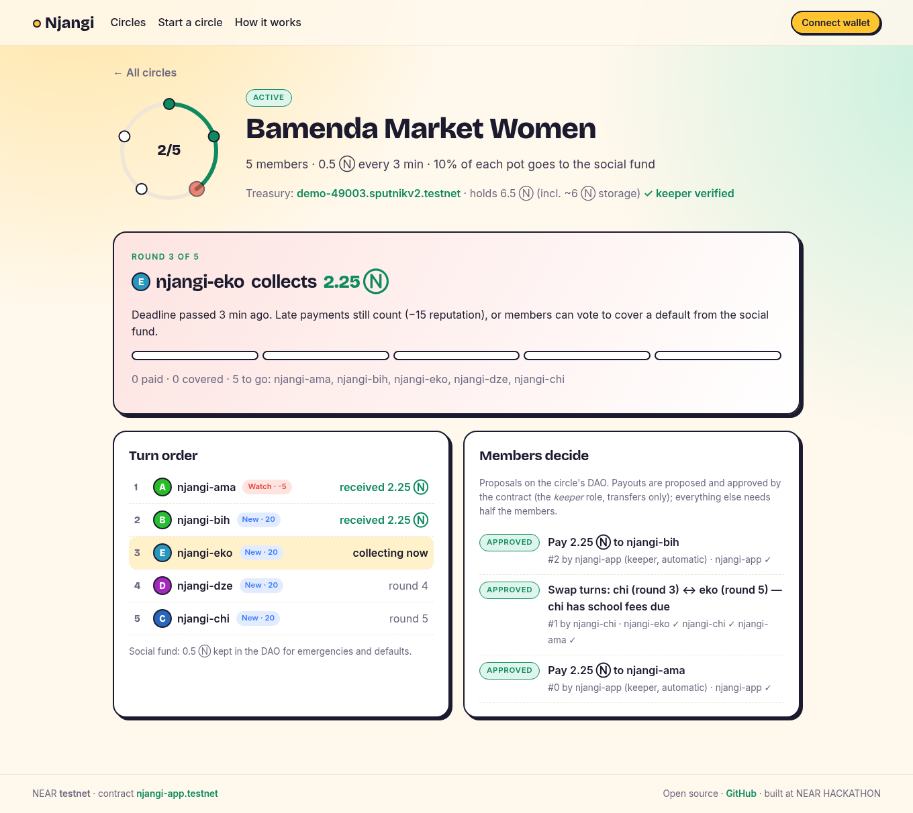

# Njangi: the savings circle no treasurer can run off with

**Live app (NEAR testnet):** https://mbanyadev.github.io/njangi/
**Contract:** [`njangi-app.testnet`](https://testnet.nearblocks.io/address/njangi-app.testnet) · **Tracks:** Social Money (primary), Real-World Money



Across Cameroon and much of Africa, people save in a **njangi** (also called a tontine, chama, susu or ROSCA). A circle of friends, traders or
colleagues each pay the same amount every week or month, and one member takes the whole pot, turn by turn. It is how people pay school fees,
restock a market stall or cover a funeral. It all depends on trusting **one treasurer**, and treasurers do sometimes run off with the money.

Njangi keeps the social part of the circle and removes the treasurer:

- **Each circle gets its own [Sputnik DAO](https://github.com/near-daos/sputnik-dao-contract)** as its treasury. Contributions go straight into the DAO, never to a person.
- **The contract is the DAO's _keeper_.** That role can only propose and approve `Transfer` proposals. When the last member pays, the contract files the payout proposal and approves it **in the same transaction**, so the pot lands with that round's member right away.
- **Members decide everything else on the DAO.** That includes swapping turns when someone has an emergency, or covering a missed payment from the circle's social fund. Each needs half the members to approve.
- **Reputation is public and portable.** On time +10, late −15, default −50, completing a circle +20. Circles can set a minimum score, so a good record gets you into bigger circles.

No new multisig and no custom custody code. The money sits in battle-tested Sputnik DAO contracts, and the circle logic only decides *when* the keeper may pay *whom*.

## Try it in 2 minutes (judges)

| Do this | You should see |
|---|---|
| Open https://mbanyadev.github.io/njangi/ | The home page with live stats read from testnet: circles, members, NEAR paid out automatically |
| Click the **Bamenda Market Women** card | The turn order, who already received the pot, and the DAO's proposals. Payouts are marked *keeper, automatic*; the turn-swap shows member votes |
| Click **njangi-ama** | Her reputation: +10 for paying on time, −15 for paying late, so she's in the "Watch" tier |
| Click **Start a circle**, connect a testnet wallet (MyNearWallet or Meteor), and list your account plus a friend's, with *5 minutes (demo)* | A new `<name>.sputnikv2.testnet` DAO is created (6 Ⓝ testnet storage deposit). Your circle appears on the home page as *Forming* |
| Have the friend open the circle and click **Join**, then both click **Pay** | When the second payment lands, the pot (minus the social-fund share) arrives in the first member's wallet, with no extra click |

Or run the whole story from a terminal (needs [near-cli-rs](https://github.com/near/near-cli-rs) and five funded testnet accounts named `njangi-ama|bih|chi|dze|eko.testnet`):

```bash
./scripts/demo.sh   # create -> join -> round 1 auto-payout -> DAO vote to swap turns -> late payment -> round 2 auto-payout
```

## How it works

```
member ──contribute(0.5 Ⓝ)──▶ njangi-app.testnet ──transfer──▶ circle DAO (Sputnik v2)
                                    │  last payment of the round?
                                    ├─ add_proposal(Transfer pot → beneficiary)   (keeper role)
                                    └─ act_proposal(VoteApprove)  ── threshold 1/1 ──▶ DAO pays the beneficiary
members ──add_proposal / VoteApprove──▶ circle DAO ──FunctionCall──▶ dao_swap_turns / dao_cover_default
```

DAO policy written by `create_circle`:

| Role | Who | Can | Threshold |
|---|---|---|---|
| `keeper` | the Njangi contract only | `transfer:AddProposal`, `transfer:VoteApprove` | 1 of 1 for transfers |
| `members` | the circle's members | add, approve, reject or finalize any proposal | ½ of members |

Before a circle can start, the contract reads the new DAO's policy back from chain (`get_policy`) and checks that the keeper group is exactly this contract (`dao_ready`).

### Contract API (`contract/src/lib.rs`)

| Method | Who | What |
|---|---|---|
| `create_circle(name, dao_name, members, contribution, period_secs, fund_bps, min_reputation)` + 6 Ⓝ | a member | Creates the circle and its DAO |
| `join(circle_id)` | invited member | Accepts the invite (reputation gate); the circle starts when everyone has joined |
| `contribute(circle_id)` + exact amount | member | Pays this round. The last payer triggers the payout (attach 300 Tgas) |
| `release(circle_id)` | anyone | Retries the payout if a round is settled but unpaid |
| `dao_swap_turns(circle_id, a, b)` | the circle's DAO | Swaps two future turns |
| `dao_cover_default(circle_id, member)` | the circle's DAO | Marks an overdue member as covered by the social fund (−50 reputation) |
| `get_circles`, `get_circle`, `get_round`, `get_reputation`, `get_member_circles`, `get_config` | view | |

Events are emitted as NEP-297 `EVENT_JSON` with standard `njangi`.

## Verified on testnet

- Circle 0, DAO [`demo-49003.sputnikv2.testnet`](https://testnet.nearblocks.io/address/demo-49003.sputnikv2.testnet):
  - Round 1 paid 2.25 Ⓝ to ama automatically (DAO proposal #0, *Approved* by the keeper).
  - Members voted 3/5 to swap chi's and eko's turns (proposal #1).
  - Round 2 paid bih (proposal #2) after ama paid late (her reputation is now −5).
- 14 unit tests (`cd contract && cargo test`) cover activation, the policy check, exact payments, late payers, release retries, completion, swaps, DAO-only methods, covering defaults, and the reputation gate.

## Run it yourself

```bash
# contract
cd contract && cargo test && cargo near build non-reproducible-wasm
near contract deploy <your-account>.testnet use-file target/near/njangi.wasm \
  with-init-call new json-args '{"factory":"sputnikv2.testnet"}' prepaid-gas '100.0 Tgas' attached-deposit '0 NEAR' \
  network-config testnet sign-with-keychain send
# web
cd web && npm ci && npm run dev     # set CONTRACT in web/src/near.ts
```

## Honest limits

- **Testnet only.** Mainnet would need an audit, and a stablecoin option (for example USDC through the DAO's FT transfers) so that savings aren't exposed to NEAR's price.
- A member who never pays can only be *covered* by a vote. There is no collateral yet; reputation and the minimum-reputation gate are the deterrent.
- Each circle costs about 6 Ⓝ of DAO storage. A shared-DAO mode for tiny circles is a possible next step.

## Built with AI

Built during NEAR HACKATHON (Nov 2026) by Mbanya Dev with AI coding assistance. All code in this repo was written during the hackathon.

MIT licensed.
